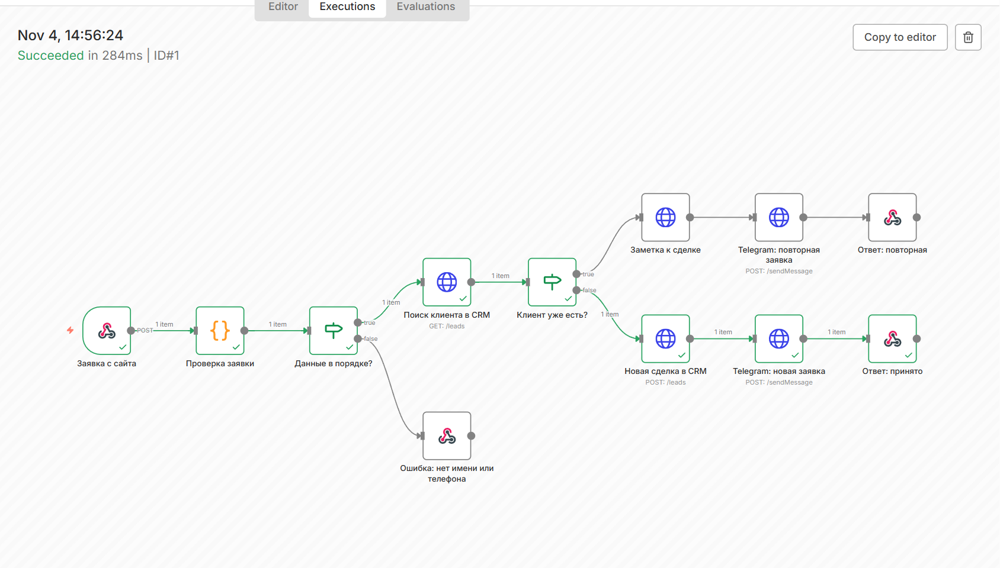
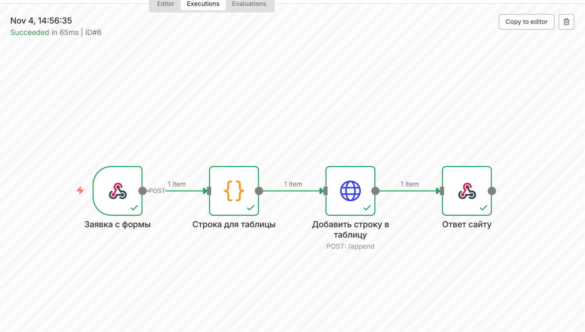
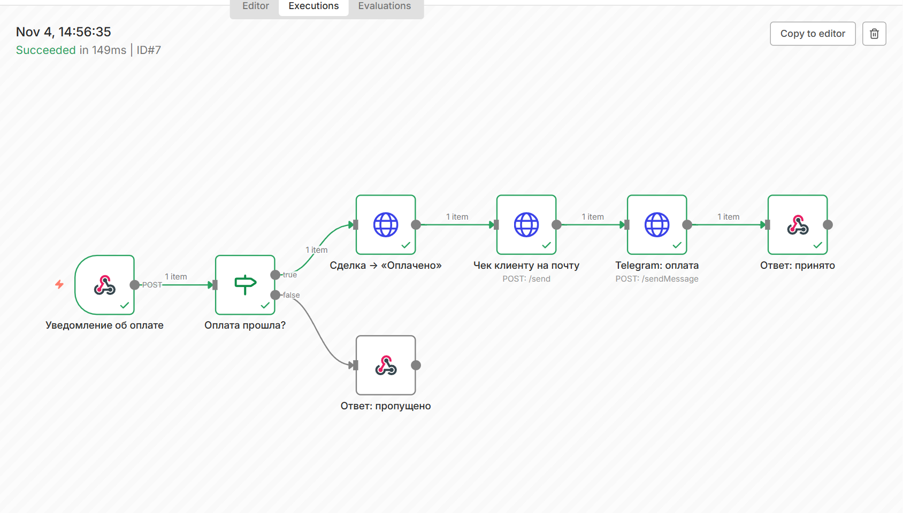
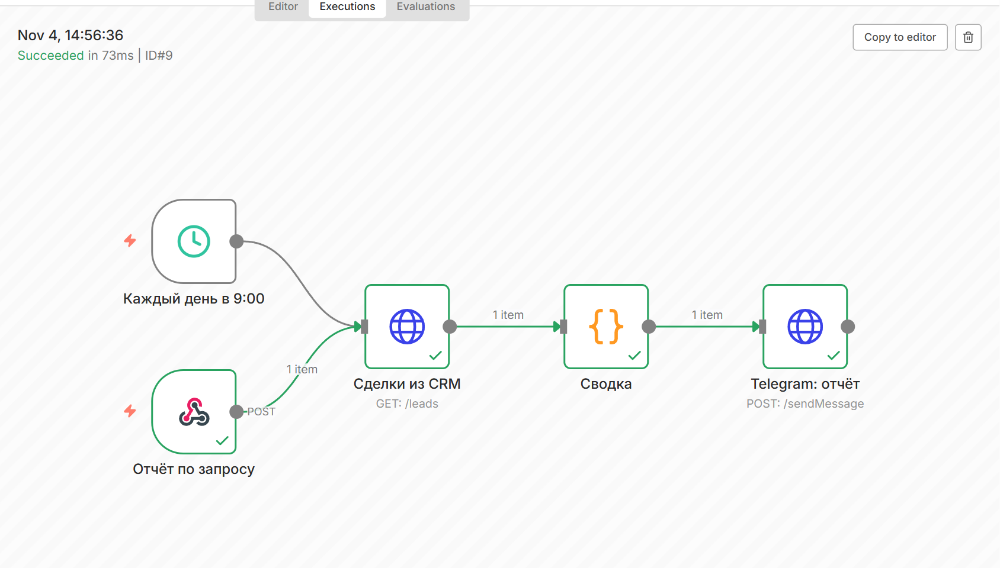
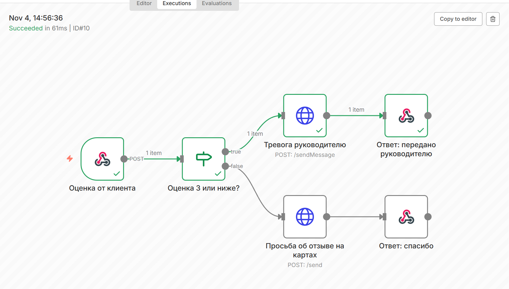

# Автоматизация заявок в n8n

Пять сценариев [n8n](https://n8n.io) для малого бизнеса: заявки, таблица, оплаты, отчёты и отзывы. Сценарии собираются кодом ([build_workflows.py](build_workflows.py)), импортируются в n8n при старте и проверяются автотестом.

| Сценарий | Что делает |
|---|---|
| 1. Заявка → CRM → Telegram | Проверяет имя и телефон (приводит к +7), ищет клиента в CRM: новый — создаёт сделку, повторный — добавляет заметку. Менеджеру — сообщение |
| 2. Заявка → Google Таблица | Строка: дата, имя, телефон, источник рекламы (utm), страница |
| 3. Оплата → CRM → чек | Уведомление от платёжной системы: сделка → «Оплачено», письмо клиенту, сообщение менеджеру. Отмены пропускаются |
| 4. Отчёт в Telegram | Каждый день в 9:00 (или по запросу): сколько сделок, сколько оплачено и на какую сумму |
| 5. Отзыв клиента | Оценка 1–3 → тревога руководителю, 4–5 → просьба оставить отзыв на картах |



<details>
<summary>Остальные сценарии</summary>






</details>

## Запуск и проверка

```bash
docker compose up -d --wait     # n8n: http://localhost:5678
python check.py                 # включает сценарии и прогоняет тестовые заявки
```

`check.py` при первом запуске создаёт владельца локального n8n (пароль и ключ API сохраняются в `.env`, он в `.gitignore`), включает сценарии через API n8n и шлёт заявки, оплаты и отзывы на вебхуки. CRM, Telegram, таблица и почта в демо — заглушка [mock/app.py](mock/app.py): она записывает каждый вызов, а тест сверяет, что сценарий отправил ровно то, что нужно. Последний прогон: 8 проверок, все прошли.

У клиента вместо заглушки — его amoCRM, Битрикс24, Google Таблица и бот: меняются адреса в `docker-compose.yml` и поля запросов под API конкретной CRM.

`node shots.cjs` снимает схемы сценариев из редактора n8n для `docs/`.
